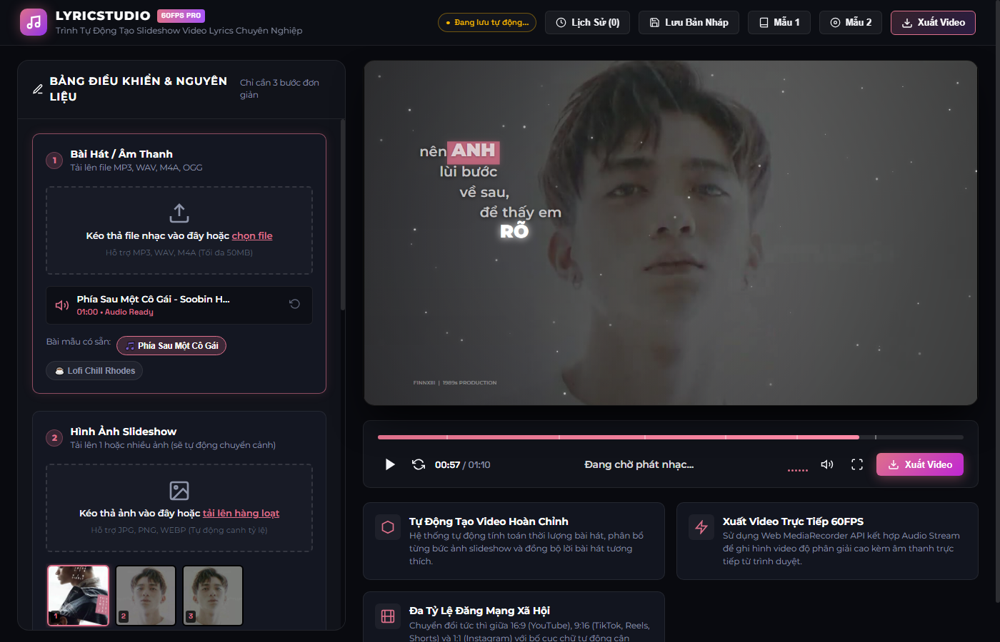

# 🎵 LyricStudio Pro — Kinetic Typography & Slideshow Video Studio

> **Ứng dụng web tự động tạo video slideshow kèm lyrics động (kinetic typography) 60FPS chuyên nghiệp trực tiếp trên trình duyệt, lấy cảm hứng từ ngôn ngữ thiết kế của FinnXIII trong video *"Phía Sau Một Cô Gái" (Soobin Hoàng Sơn)*.**



---

## ✨ Điểm nổi bật & Tính năng chính

### 1. 🎤 True Word-by-Word Kinetic Typography
- **Xuất hiện từng từ chuẩn xác:** Từng từ hiển thị chính xác theo từng âm tiết và giọng hát của ca sĩ thay vì hiện cả câu cứng nhắc.
- **Bố cục bậc thang đa dòng (Multi-line Cascading Staircase):** Tự động phân đoạn thành các cụm từ ngắn (2–3 từ/dòng), xếp so le bậc thang với độ thụt lề linh hoạt (+42px ở 16:9, +20px ở 9:16).
- **Hộp dạ quang Dusty Rose (`#DE708B`):** Tự động phát hiện và bọc các từ/cụm từ khóa quan trọng (*đôi mắt, ANH, EM, CÔ GÁI...*) trong một dải hộp nguyên khối quét ngang uyển chuyển với ánh hào quang rực rỡ khi chạm nốt.
- **Hiệu ứng chữ hoa & Xếp tầng (Stacked Words):** Hỗ trợ phóng lớn chữ hoa (`font-weight: 900`) và xếp dọc các từ cao trào (*LẤP / LÁNH*).

### 2. ⚡ Động lực học & Chuyển động siêu mượt (60FPS Physics)
- **Đường cong giảm tốc mượt mà (Soft Deceleration Curve):** Thời lượng xuất hiện $440\text{ms}$ kết hợp độ trôi nhẹ $9\text{px}$ và hàm giảm tốc bậc 3.2:
  $$\text{ease}(t) = 1 - (1 - t)^{3.2}$$
- **Khử giật Raster (220ms Alpha Feathering):** Chữ nở ra mềm mại từ nền tối, triệt tiêu hoàn toàn hiện tượng chớp nháy (1-frame pop).
- **Organic Holding Micro-Drift:** Sau khi vào vị trí, chữ tiếp tục trôi nhẹ lên trên $\approx 0.22\text{px/s}$, tạo cảm giác lơ lửng tự nhiên như After Effects.
- **Sub-frame Audio Clock Smoothing:** Tích hợp `performance.now()` khử độ trễ bước $20-40\text{ms}$ của phần cứng âm thanh, giúp vòng lặp Canvas chuyển động tuyệt đối không bị giật khung hình.

### 3. 🎨 Lớp phủ mờ nền tăng độ tương phản (Editorial Typography Scrim)
- Phủ một lớp gradient than mờ chuyển sắc mềm mại ở nửa trái khung hình (`rgba(8, 10, 16, 0.62)` $\to$ `0.0`), kết hợp vignette xuyên tâm và phim màu $26\%$.
- Giúp khối chữ màu trắng và dải hộp màu hồng phấn hiển thị sắc nét $100\%$ trên mọi bức ảnh nền mà không làm mất đi thần thái chủ thể ở nửa phải.

### 4. 🎭 5 Mẫu thiết kế chuyển động (Graphic Templates)
1. **FinnXIII Sharp Editorial:** Tái hiện chuẩn mực video *"Phía Sau Một Cô Gái"* — 3 dải cắt chéo Parallax ($-18.5^\circ$), thẻ tên dọc 3D Origami ribbon `OFFICIAL`, hộp dusty rose `#DE708B`.
2. **Lofi Chill Vinyl:** Đĩa than xoay chậm, hạt bụi sao lấp lánh, hiệu ứng viên thuốc capsule bo tròn nền pastel mờ.
3. **Neon Cyberpunk:** Đường cắt công nghệ REC 60FPS, ánh sáng neon laser cyan/magenta, hiệu ứng quang sai chromatic glitch.
4. **Vintage 1980s Cinema:** Khung viền phim 35mm, hạt nhiễu grain hoài cổ, phông chữ serif cổ điển màu kem ấm.
5. **Karaoke Pop:** Quét màu chuyển sắc gradient rực rỡ theo từng từ với nốt nhạc bay sinh động.

### 5. 📱 Đa tỷ lệ khung hình & Mạng xã hội
- **16:9 Widescreen:** Tối ưu hóa cho YouTube, TV và màn hình ngang ($1280 \times 720$).
- **9:16 Vertical Video:** Tối ưu cho TikTok, Instagram Reels, YouTube Shorts ($720 \times 1280$).
- **1:1 Square:** Tối ưu cho Instagram Feed, Facebook Post ($1080 \times 1080$).

### 6. 🎬 Xuất video 60FPS trực tiếp không cần Backend
- Sử dụng **HTML5 Canvas CaptureStream** và **Web Audio API** kết hợp **MediaRecorder API**.
- Xuất tệp video chuẩn `WebM / MP4` chất lượng cao ($8\text{ Mbps}$, $60\text{FPS}$) tích hợp sẵn âm thanh đã đồng bộ ngay từ trình duyệt.

### 7. 💾 Tự động lưu bản nháp & Quản lý lịch sử dự án
- Tự động lưu tức thì vào `localStorage` khi có bất kỳ thay đổi nào (ảnh, âm thanh, lời bài hát, mẫu hiển thị).
- Chụp ảnh thumbnail lưu bản nháp dự án có đặt tên.
- Hỗ trợ Export / Import toàn bộ dự án dưới dạng tệp `JSON`.

---

## 📂 Cấu trúc thư mục

```
lyrics-slideshow-studio/
├── index.html              # Giao diện chính Studio Pro (Dark Glassmorphism)
├── server.py               # Local server Python nhẹ (hỗ trợ CORS và MIME)
├── .gitignore              # Bộ lọc loại bỏ tệp tạm
├── README.md               # Tài liệu dự án
├── css/
│   └── style.css           # Toàn bộ CSS phong cách Studio hiện đại
├── js/
│   ├── app.js              # Bộ điều khiển UI, Audio Clock Smoothing & Lyrics Parser
│   ├── engine.js           # Bộ dựng đồ họa Canvas 60FPS, Ken Burns & Particle Engine
│   ├── templates.js        # Định nghĩa 5 templates & đồ họa kinetic typography
│   ├── recorder.js         # Bộ thu xuất video MediaRecorder API 60FPS
│   └── history.js          # Trình quản lý Auto-Save & Project History
├── assets/
│   └── samples/            # Âm thanh và hình ảnh mẫu chất lượng cao
└── docs/
    └── preview.png         # Ảnh chụp giao diện xem trước
```

---

## 🚀 Hướng dẫn cài đặt & Khởi chạy

Dự án hoàn toàn thuần túy phía client (Vanilla JS, HTML5 Canvas, Web Audio API), không phụ thuộc vào các thư viện nặng nề như Webpack hay Node build tools.

### 1. Clone repository về máy
```bash
git clone https://github.com/quanggiaphthh/lyrics-slideshow-studio.git
cd lyrics-slideshow-studio
```

### 2. Khởi chạy máy chủ cục bộ
Có thể sử dụng bất kỳ máy chủ tĩnh nào (Python, Node, Live Server, Nginx...):

**Sử dụng Python (đã có sẵn `server.py`):**
```bash
python server.py
```
Máy chủ sẽ lắng nghe tại cổng `http://localhost:5000`.

**Hoặc dùng module chuẩn của Python:**
```bash
python -m http.server 5000
```

### 3. Mở ứng dụng
Truy cập trình duyệt (ưu tiên Google Chrome, Microsoft Edge hoặc Firefox phiên bản mới nhất):
👉 **`http://localhost:5000`**

---

## 🛠️ Hướng dẫn sử dụng nhanh

1. **Chọn bài hát / Âm thanh:**
   - Kéo thả tệp âm thanh (MP3, WAV, M4A, OGG) vào ô tải lên, hoặc nhấn chọn bài hát mẫu có sẵn (*Phía Sau Một Cô Gái* hoặc *Lofi Chill*).
2. **Chọn hình ảnh Slideshow:**
   - Kéo thả một hoặc nhiều bức ảnh (JPG, PNG, WEBP) làm nền chuyển động Ken Burns.
3. **Chọn Template & Tỷ lệ khung hình:**
   - Chọn 1 trong 5 phong cách: *FinnXIII Sharp*, *Lofi*, *Cyberpunk*, *Vintage*, *Karaoke*.
   - Chọn tỷ lệ mong muốn: *16:9*, *9:16*, *1:1*.
4. **Đồng bộ lời bài hát (Lyrics):**
   - Nhập lời bài hát dạng chuẩn LRC `[mm:ss.xx]` hoặc nhấn nút **"Tự động căn chỉnh"**.
5. **Xem trước & Xuất Video:**
   - Nhấn **Phát** hoặc nhấn phím cách (`Space`) để xem trước chuyển động ở $60\text{FPS}$.
   - Nhấn nút **"Xuất Video"** để ghi hình trực tiếp và tải về tệp video thành phẩm.

---

## 📖 Tài liệu kỹ thuật & Kiến trúc (Documentation)

- [AGENTS.md](AGENTS.md): Quy chuẩn cho AI agent / kỹ sư tiếp quản dự án.
- [docs/PROJECT_GOAL.md](docs/PROJECT_GOAL.md): 7 Mục tiêu cốt lõi và tiêu chuẩn hoàn thành (Definition of Done).
- [docs/MASTER_PLAN.md](docs/MASTER_PLAN.md): Lộ trình nâng cấp từ G0 đến G6, mã định danh task và trạng thái.
- [docs/PROJECT_MEMORY.md](docs/PROJECT_MEMORY.md): Nhật ký phiên làm việc, mốc commit SHA và lịch sử kiểm thử.
- [docs/DECISIONS.md](docs/DECISIONS.md): Hồ sơ quyết định kiến trúc (ADRs).
- [docs/QA_EVIDENCE.md](docs/QA_EVIDENCE.md): Bằng chứng kiểm thử tự động, log probe và chứng thực chất lượng.

---

## 📜 Giấy phép (License)

Dự án được phát hành theo giấy phép [MIT License](LICENSE).
Tự do sử dụng, chỉnh sửa và tích hợp cho các dự án cá nhân hoặc thương mại.
